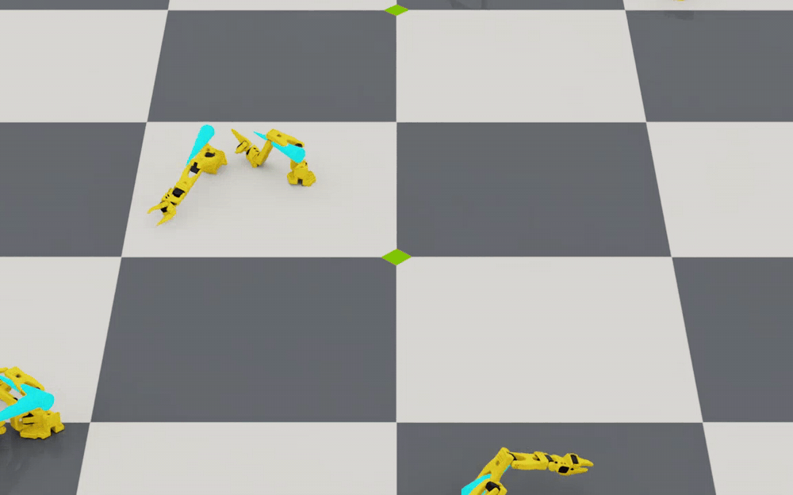

# Zombie Crawl — RL Specification

A free-floating **SO-ARM100** (6-DOF arm, no fixed base) that is trained with **PPO**
(RSL-RL) to drag its body forward along world **+X** on flat ground, crawling at
~6–10 cm/s. This file documents the three things that define the task: the **reward
function**, the **neural-network models**, and the **termination conditions**. 



*Training overview clip: a grid of parallel SO-ARM100 policies crawling toward their own
randomly commanded headings (single world-space viewer camera, one clip every 200 PPO
iterations).*

Source of truth (all under `source/zombie_crawl/zombie_crawl/tasks/manager_based/crawl/`):

| Concern       | File                                    |
|---------------|-----------------------------------------|
| Env + all configs | `crawl_env_cfg.py`                  |
| Reward terms  | `mdp/rewards.py`                        |
| Terminations  | `mdp/terminations.py`                   |
| PPO / networks| `agents/rsl_rl_ppo_cfg.py`              |
| Observations  | `crawl_env_cfg.py` + `mdp/observations.py` |
| Curriculum    | `mdp/curriculums.py`                    |

**Coordinates:** world frame, right-handed. +Z = up. The robot points along its **jaw axis
= base-frame −Y** (the URDF arm chain hangs off `y = −0.045`; zero-pose FK puts the jaw tip
at y ≈ −0.15). Each episode draws a **commanded direction: uniform ±180°, independent of the
spawn facing**, frozen for the episode in `env.zombie_ref_yaw` by `mdp.reset_start_pose`.
Every directional reward/curriculum/termination scores motion along that commanded axis,
and the `heading_error_wrist` observation shows the actor the claw-vs-command angle — so
the skill is *turn to the command, then crawl it head-first*. The command never follows the
robot, so turning cannot farm it. Spawn facings stay uniform ±180° (independent of the
command). Evals force spawn yaw 0; `evaluate.py` scores displacement projected on the
command axis.

---

## 1. Reward function

Scored at every control step (50 Hz). The episode reward is the sum of the terms below,
each weighted. Positive terms maximize, negative terms penalize.

| # | Term | Weight | Shape | Plain meaning |
|---|------|-------:|-------|---------------|
| 1 | `forward_velocity`  | **+1.5** | `tanh(v / v_target)`, gated up, **negative down** | The main term. Pull toward `v_target` along the reference (jaw) axis; flattens once reached; **backward crawling scores negative**, so forward/backward oscillation nets ~zero. |
| 2 | `forward_progress`  | +1.0 | 1 Hz low-passed displacement along the reference (jaw) axis (τ = 1 s) | Immune to back-and-forth oscillation; shapes end-of-episode displacement directly. |
| 3 | `alive`             | +0.05 | 1.0 each step the episode is alive | Keeps the running score positive. Phase 2: halved for value contrast. |
| 4 | `wrist_pointing`    | −2.0 | `1 − cos(Δyaw)` of base→wrist arrow vs reference axis | Penalizes pointing the claw off the commanded direction (arm-aware, unlike the old base-yaw axis); strong enough that crab-walking never pays. |
| 5 | `lateral_velocity`  | −1.0 | `vy²` perpendicular to the reference (jaw) axis | Penalizes swaying sideways. |
| 6 | `vertical_velocity` | −2.0 | `vz²` | Anti-hop: penalizes moving up/down. |
| 7 | `base_height`       | −1.0 | `(z − 0.005)²` | Anti-launch: penalizes rising off the crouch resting height (~0.5 cm). |
| 8 | `orientation`       | −0.5 | L2 of flat-orientation error | Penalizes tilting/rolling off its "belly" orientation. |
| 9 | `overspeed`         | −2.0 | `relu(vx − 2·v_target)²` | Anti-exploit: quadratic wall once faster than 2× target. |
| 10| `action_rate`       | −0.01 | `‖a_t − a_{t-1}‖²` | Smoothness: penalizes whipping joints. |
| 11| `joint_acc`         | −1e-4 | joint-acceleration L2 | Smoothness: penalizes jerk. |
| 12| `joint_limits`      | −0.5 | L2 of limit violation | Penalizes driving joints to the edge of their range. |
| 13| `joint_torques`     | −1e-5 | torque L2 | Cheap-motion: penalizes high torque. |
| 14| `joint_deviation`   | −1e-3 | `‖q − q0‖²` | Very weak pull back toward the default rest pose. |
| 15| `low_ground_contact`| 0.0 | *(disabled)* | Optional "stay low to the ground" bonus — off by default. |
| 16| `gait_asymmetry`    | 0.0 | *(disabled)* | Optional "alternate legs" bonus — off by default. |

**How to read the scale (phase 2).** The main term is now `tanh(vx / v_target)` at
weight 1.5 (still gated on real motion, still capped by the `overspeed` wall at 2× target):
**linear** gradient at low speed (d/da = 1/v_target) instead of a saturated Gaussian bell.
`forward_progress` is now a **1 Hz low-passed displacement** at weight 1.0 — same units as
velocity, immune to jerky back-and-forth oscillation, shaping end-of-episode displacement
directly. `v_target` remains curriculum-driven (0.06 → 0.10 m/s, §4).

**The gradient problem was the phase-1 bottleneck** (bell ≈ 0.37 nearly everywhere at
~1–2 cm/s, progress term weightless). Phase 2 fixes it with the tanh + LPF design above;
the phase-1 run (2026-10-12_02-15-00) still reached 0.445 m / 20 s — the phase-2 run
targets the 1 m / 20 s bar.

---

## 2. Neural-network models

Framework: **RSL-RL 5.5.1 PPO**, **asymmetric actor-critic** (the critic sees privileged
state the actor never sees). Two MLPs, both with empirical observation normalization.

| Network | Architecture | Activation | Notes |
|---------|--------------|------------|-------|
| **Actor** | `256 → 128 → 64` | ELU | Outputs a **diagonal Gaussian** over the 6-DOF limits-relative joint-position action. `init_std = 0.4`. |
| **Critic** | `256 → 128 → 64` | ELU | Value estimate; sees the actor obs **+ 5 privileged dims**. |

**Observations**

- **Actor (policy) group — 25-D** (27-D if the optional gait clock is on). Hardware-plausible
  only, with observation noise: projected gravity, base angular velocity, joint positions
  (relative), joint velocities, last actions.
- **Critic (privileged) extra group — 5-D:** base linear velocity, base height, ground
  friction. Concatenated with the policy group by the runner — this is the "asymmetric" part.

**Actor observations** (27-D, normalized): projected gravity, base angular velocity,
joint positions (rel. to the folded default), joint velocities, last action — all
egocentric — plus **`heading_error_wrist`**: (cos, sin) of the angle between the world-frame
arrow *base origin → wrist* and the frozen reference axis. The arrow points where the
robot must crawl, so the actor directly sees the pointing error the `wrist_pointing` reward
uses instead of only feeling it. Caveat: this term needs the wrist's *world* position
(external localization) — it is the only non-proprioceptive observation; remove it for a
strict sim-to-real policy. Critic-only extras: base linear velocity, base height, ground
friction (asymmetric actor-critic).

**Action:** 6-D joint **positions** via the **limits-relative** mapping
(`EMAJointPositionToLimitsAction`) — a raw action in [−1, +1] maps onto each joint's own
**soft** position limits (−1 = low, +1 = high; with `soft_joint_pos_limit_factor = 0.95`
that is the middle 95% of each joint's hard range, shrunk symmetrically about the default
position, which is the folded spawn). A custom subclass (`mdp/actions.py`) maps **zero action to the folded
spawn pose** while `a=±1` still reach each joint's full soft limits (two-sided piecewise
about the neutral). The stock map (zero = joint-range midpoint) opened every episode with a
stand-up kick; an affine-offset variant halved the one-sided joints' reachable ranges, which
forced the robot into a sideways crab-walk exploit. Policy covers each joint's full motion
(the old fixed ±0.5 rad window covered only 16–45%).
EMA-smoothed (`alpha=0.3`, state re-initialized to the current joint positions on reset,
so episodes don't start with a jump); raw magnitude clipped to ±1.

**PPO hyperparameters** (`rsl_rl_ppo_cfg.py`):

| Param | Value | Param | Value |
|-------|-------|-------|-------|
| `num_steps_per_env` | 24 (0.48 s/rollout) | `gamma` | 0.99 |
| `max_iterations` | 3000 | `lam` | 0.95 |
| `clip_param` | 0.2 | `entropy_coef` | 0.005 |
| `learning_rate` | 1e-3 (adaptive) | `desired_kl` | 0.01 |
| `value_loss_coef` | 1.0 | `num_learning_epochs` | 5 |
| `use_clipped_value_loss` | True | `num_mini_batches` | 4 |
| `max_grad_norm` | 1.0 | `schedule` | adaptive |

**Known model problem (fixed: `init_std` set to 0.4).** `init_std = 1.0` on a **±1-clipped** action space puts most of the
Gaussian's mass outside the clip, so sampled actions saturate (observed raw actions
`|a| ≈ 18`, clipped to ±1) and the policy gradient through the clip is sparse. A standard
fix is `init_std ≈ 0.3–0.5`. With the limits-relative action space, a saturated raw action
means the policy is pressing a joint toward its **hard limit**, not toward ±0.5 rad —
persistent saturation on one joint is now a signal to check the `joint_limits` reward
weight or that joint's effective range.

---

## 3. Termination conditions

**Design intent: tipping over is *allowed*.** A crawler may flip itself; that is *not* a
failure. Episodes end only on numerical failure, being flung into the air, leaving the
bounding area, or the time limit.

| Term | Trigger | Type |
|------|---------|------|
| `time_out` | episode reaches **20 s** | truncation (bootstrap) |
| `base_nan` | any NaN/Inf in root or joint state | failure |
| `base_too_high` | base origin z > **0.45 m** (physics-exploit guard) | failure |
| `out_of_bounds` | \|dx\| > **2.5 m** or \|dy\| > **1.5 m** from the env origin | failure |
| `stalled` | < **0.05 m** progress along the reference (jaw) axis within **12 s** | failure |

**Why this matters for learning.** Because tipping is not a failure and the bounds are
large, most episodes run the full 20 s and `alive` is earned almost every step. That yields
flat value estimates and little contrast between good and bad behavior — another suspected
contributor to slow learning.

---

## 4. Curriculum (drives `v_target` and friction)

Enabled by default (`use_curriculum=True`). Two knobs advance as the population improves:

- **`v_target`:** 0.06 → 0.10 m/s, +0.005 step. Advances only when the population mean of
  a 2 s EMA of reference-projected speed > 60% of the current target **and** mean episode
  length > 50% of max (an instantaneous snapshot is inflated by flailing and advanced the
  difficulty on bogus evidence).
- **`friction_scale`:** 1.5 → 1.0, −0.05 step. Same EMA gate; decays the extra
  ground-friction multiplier as the robot gets faster. (Per-env base friction is sampled at startup, effective
  ~0.5–1.2, and is also exposed to the critic as a privileged observation.)

---

## 5. "Not learning" — open items

Observed: the best checkpoint moves ~1 cm/s and raw actions saturate at the ±1 clip. The
likely culprits, in order:

1. **`init_std = 1.0` too large** → saturated actions, sparse gradient. **Fixed: set to 0.4.**
2. **Weak reward gradient:** main bell nearly saturated at slow speeds; `forward_progress`
   under-weighted. Rebalance (widen the bell / raise progress weight / lower `v_target_start`).
3. **Long, rarely-failing episodes:** flat values, low contrast. Consider a tip/instability
   termination or a shorter horizon.
4. **Action-space coverage (addressed):** the old ±0.5 rad window around the default pose
   covered only 16–45% of each joint's measured range of motion (gripper bottom edge was
   exactly its hard limit; wrist_roll 16%), so a gait needing larger excursions was
   unrepresentable. The action term is now **limits-relative** (§2): raw −1…+1 spans each
   joint's soft range (95% of the hard range). Note raw 0 now means "soft-range midpoint",
   not "default pose" — the EMA state is re-initialized to the reset pose, so this only
   matters as a steady-state bias, not as an episode-start jump.

---

## Run

```bash
source /home/yousof/robotics/experimental/zombie_crawl/scripts/env.sh
cd /home/yousof/robotics/experimental/zombie_crawl
```

### 1. Smoke test, headless, with video

Short run (64 envs) that verifies the full pipeline and writes at least one complete
training clip. A clip is 2000 env steps long (40 s = two full episodes); recording is
suppressed until iteration 100, so the first clip runs ~iterations 101-185 — use
`--max_iterations 190` or no clip will finish.

```bash
python scripts/train.py --task Zombie-Crawl-SO100-v0 \
    --num_envs 64 --max_iterations 190 --video --headless
# → logs/rsl_rl/zombie_crawl/<timestamp>/videos/train/train_overview_0000.mp4 (4K)
```

### 2. Full training, headless, with video

The real run. One ~40 s 3840×2160 overview clip every 200 PPO iterations, starting at
iteration 100 (the warm-up phase is not recorded; all clips kept
on disk, `keep_last_n_clips=None`). Frames stream straight into ffmpeg at full rate
(`frame_stride=1`, 50 fps playback) via the task's `StreamingVideoRecorder`
(`streaming_recorder.py`), so host RAM stays constant — the stock in-RAM buffer would
need ~66 GB for a clip this size.

```bash
python scripts/train.py --task Zombie-Crawl-SO100-v0 \
    --num_envs 4096 --max_iterations 3000 --video --headless
```

Notes on `--video`:

- `--video` is what turns recording on; without it no `videos/` directory is created.
- The source is a SINGLE world-space viewer camera framing the env-grid centre (several
  robots visible at once), never a per-env camera (that OOMs at 4096). Cost is one 4K
  viewport render per step and is independent of `--num_envs`.
- Tune with `--video_length` / `--video_interval` (env steps); resolution/fps come from
  `CrawlEnvCfg`. Headless frames are fresh (not the old frozen-viewport bug) — see
  [docs/video_fix.md](docs/video_fix.md).

### 3. Resuming interrupted training

Checkpoints are written every 50 iterations as `<run_dir>/model_<iter>.pt` under
`logs/rsl_rl/zombie_crawl/`. Resume the **latest checkpoint of the latest run** with the
launcher's checkpoint selector:

```bash
python scripts/train.py --task Zombie-Crawl-SO100-v0 \
    --num_envs 4096 --max_iterations 3000 --video --headless --checkpoint latest
```

Pitfalls (all verified):

- `--checkpoint latest` picks the *newest directory* in `logs/rsl_rl/zombie_crawl/`. An
  aborted launch leaves an empty new dir that outranks the real one — delete stray dirs
  (contents just `run.json`/`model_0.pt`) before resuming.
- Resuming creates a NEW run dir that continues the iteration counter; the old dir stays
  untouched.
- Do NOT use `--load_run` (rejected: the 3.0 CLI is Hydra-based) and do NOT pass a run-dir
  path to `--checkpoint` (path gets joined twice → `FileNotFoundError`). To continue from a
  specific checkpoint instead of the newest, make it the newest `.pt` in the newest run
  dir (e.g. move later ones aside).
- `--max_iterations` is the TOTAL budget; resuming at 600 with 3000 keeps 2400 to go.

### 4. GUI mode (watch it live)

In 3.0 the launcher is headless by default; `--viz kit` opens the Kit window (and
`--headless` forces headless, e.g. to override a visualizer that would otherwise open a
window — relevant with `--video`). Use a small `--num_envs` so the viewport stays fast;
only env_0 is rendered regardless.

```bash
# Watch training in the Kit viewport:
python scripts/train.py --task Zombie-Crawl-SO100-v0 \
    --num_envs 64 --max_iterations 100 --viz kit

# Same, but also recording headless overview clips to disk:
python scripts/train.py --task Zombie-Crawl-SO100-v0 \
    --num_envs 64 --max_iterations 30 --video --viz kit
```

### Monitor with TensorBoard

```bash
tensorboard --logdir logs/rsl_rl/zombie_crawl
# → http://localhost:6006  (add --port 6007 if busy, or point at a single <run> dir)
```

### Diagnostics & playback

```bash
# View the robot idle:
python scripts/view_robot.py --viz kit --pose folded --preset servo

# Print the joint limits the action term (raw -1..+1) maps onto:
python scripts/print_action_limits.py

# Physically drive each joint soft-max -> soft-min through the action path:
python scripts/drive_joint_limits.py --viz kit [--preset servo]
python scripts/drive_joint_limits.py --no-idle        # headless: exit after the summary

# Record a 20 s video of a checkpoint (two angles: side + top-down):
python scripts/play.py --task Zombie-Crawl-SO100-Play-v0 \
    --checkpoint logs/rsl_rl/zombie_crawl/<run>/model_3499.pt --video
# → <run>/videos/play/side_model_3499_0000.mp4 and top_model_3499_0000.mp4
```

- `--preset servo` (2.9 N·m, real servo) vs `--preset ideal` (10 N·m, separates task-design
  from torque limits).
- `--pose folded` (the only start pose currently defined in `START_POSES`).
- `--headless` runs without a GUI window (on `train.py`/`play.py` and the test helpers).
  Isaac Lab 3.0 dropped `--headless` from the launcher CLI — headless is the default when
  no visualizer is requested — so this repo re-adds the flag as a compatibility shim that
  maps it to the launcher's `HEADLESS=1` env var (and keeps `--viz kit` working for the GUI).
- Headless `--video` records from scene camera sensors, not the GUI viewport —
  see [docs/video_fix.md](docs/video_fix.md) for how it works and why the old
  viewport-based clips came out frozen.
